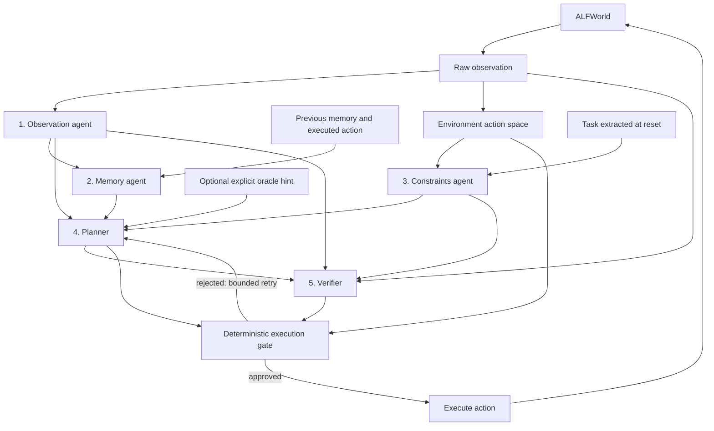

# Failure propagation and selective recovery in multi-agent ALFWorld

A plain-Python, five-role agent workflow sharing one ALFWorld text environment.
Its purpose is to make intermediate decisions and dependencies observable for
fault injection and recovery experiments. Phase 1 (an LLM planner baseline,
controlled fault injection, propagation measurement, full-restart and
always-verify baselines) is implemented; see [Phase 1 experiments](#phase-1-experiments).
Selective recomputation and world-state recovery (Phase 2) are not implemented yet.

## Recommended team: five reasoning roles and one executor

Five roles provide a useful increase in complexity: multiple branches, memory
across environment steps, and a bounded planner/verifier feedback loop. The
executor is deterministic infrastructure and is not counted as a reasoning agent.
Agents are separate logical roles and calls; they can share the same model and do
not require separate processes or GPUs.



The diagram shows repeated calls over time; the artifact graph itself remains a
DAG. Rejected attempts create new artifacts rather than modifying old ones.
The task is an artifact derived from the initial observation. Subsequent raw
observations depend on the preceding observation and executed action, preserving
the world-history path without claiming to be full world-state snapshots.

| Role | Named artifact inputs | Required output content |
| --- | --- | --- |
| `observation` | `observation` | `summary: str`, `facts: list[str]` |
| `memory` | `state`, optional `previous_memory`, `previous_action` | `summary: str`, `observations: list[str]`, `actions: list[str]` |
| `constraints` | `task`, `action_space` | `goal: str`, `allowed_actions: list[str]` |
| `planner` | `state`, `memory`, `constraints`; optional `oracle`; on retry `feedback`, `previous_plan` | `action: str`; optional `rationale` |
| `verifier` | `plan`, `state`, `constraints`, raw `observation` | `approved: bool`, `reason: str` |

Constraints form a separate branch from parsed state and memory. A fault in state
can therefore be structurally connected to planning without contaminating the
same-step constraints artifact. Whether it actually changes a decision is a
future counterfactual measurement; descendant counts alone do not measure influence.

The default verifier checks admissibility, not goal correctness. Plug in a richer
verifier to evaluate plans against the task or state. The executor always checks
the **original environment command list** as well as verifier approval, so a
mistaken constraints agent or verifier cannot bypass action admissibility.

## Run now

From `AFL-agent_recovery` (Python 3.10, Linux):

```bash
python3 -m venv .venv
source .venv/bin/activate
pip install -r requirements.lock.txt
alfworld-download
export ALFWORLD_DATA="$HOME/.cache/alfworld"
python -m unittest discover -s tests -v
PYTHONHASHSEED=0 python -m agent_recovery --trace team-001.jsonl
python verify_trace.py team-001.jsonl
```

The environment is already installed and downloaded in this workspace. Trace
filenames must be new; existing results are not overwritten. The CLI defaults
`ALFWORLD_DATA` to `~/.cache/alfworld` if unset. `alfworld-download --data-dir PATH`
can install elsewhere; set `ALFWORLD_DATA` to the same absolute directory.

The shipped configuration is an **oracle control**: four deterministic role
implementations plus a planner that selects ALFWorld's handcoded expert action.
It verifies the complete workflow without API cost. It does not demonstrate
independent multi-agent reasoning or support conclusions about LLM fault propagation.
Expert hints are explicit artifacts supplied only to the planner.

Verified locally: two five-role runs (`multi-agent-001.jsonl` and
`multi-agent-002.jsonl`) succeeded in **5 environment actions and 25 agent calls**,
with identical artifacts across repeats. The files are generated local evidence,
ignored by version control. Seeds and configuration are recorded in each trace.
Set `PYTHONHASHSEED=0` before launching Python; Python, NumPy, and the environment
are seeded and the text environment runs synchronously. Custom model hooks must
honor the supplied seed where possible; exact API reproducibility is not guaranteed.

Useful options:

```bash
# Bounded retries: at most two planner/verifier attempts per environment step.
PYTHONHASHSEED=0 python -m agent_recovery \
  --max-steps 150 --max-plan-attempts 2 --trace team-002.jsonl

# Choose an eligible game explicitly rather than the first sorted game.
PYTHONHASHSEED=0 python -m agent_recovery \
  --gamefile /absolute/path/to/game.tw-pddl --trace selected-game.jsonl

# Include all six task families in eligible game selection.
PYTHONHASHSEED=0 python -m agent_recovery \
  --task-types 1 2 3 4 5 6 --trace all-families-eligible.jsonl
```

Each invocation runs **one** game. The default task family is pick-and-place (`1`);
all games are selected from the training split. Selecting multiple task families
does not run a benchmark suite. The first sorted eligible game is used unless
`--gamefile` is supplied. Generalization to other families is not verified here.

## Hook in your agents

Edit [configs/agents.yaml](configs/agents.yaml), or supply `--agents PATH` with
the same structure. Each role is a trusted Python factory accepting optional
`kwargs` and returning an object with `run(request)`. No framework or model SDK is
required. Keep API keys in environment variables rather than YAML or trace metrics.

```yaml
schema_version: 1
oracle_hints: false
max_plan_attempts: 2
roles:
  observation:
    factory: agent_recovery.agents:ObservationAgent
  memory:
    factory: agent_recovery.agents:MemoryAgent
    kwargs: {window: 8}
  constraints:
    factory: agent_recovery.agents:ConstraintsAgent
  planner:
    factory: examples.my_agents:MyPlanner
    kwargs: {model_name: your-model}
  verifier:
    factory: agent_recovery.agents:AdmissibilityVerifier
```

Implement the template in [examples/my_agents.py](examples/my_agents.py):

```python
from agent_recovery import AgentRequest, AgentResult

class MyPlanner:
    def run(self, request: AgentRequest) -> AgentResult:
        state = request.inputs['state'].content
        memory = request.inputs['memory'].content
        constraints = request.inputs['constraints'].content
        feedback = request.inputs.get('feedback')
        # Call your model with these inputs and request.seed.
        action = choose_action(state, memory, constraints, feedback)
        return AgentResult({'action': action})
```

`choose_action` above represents your model integration. The shipped `MyPlanner`
raises `NotImplementedError` until you implement it. Replace any other role using
the same contract and its output fields in the table. Extra JSON fields are kept.

You can override factories from the CLI as well:

```bash
# After implementing MyPlanner:
PYTHONHASHSEED=0 python -m agent_recovery --no-oracle \
  --agent planner=examples.my_agents:MyPlanner --trace custom-team.jsonl

# Runnable plumbing check: LookPlanner just says 'look'; expect step-limit exit 1.
PYTHONHASHSEED=0 python -m agent_recovery --no-oracle \
  --agent planner=examples.my_agents:LookPlanner \
  --max-steps 2 --trace hook-check.jsonl
python verify_trace.py hook-check.jsonl --allow-failure
```

`--agent` can be repeated for different roles. An override replaces that role's
factory and clears its YAML kwargs; use a YAML file for constructor settings.
`--no-oracle` removes the expert wrapper, expert hints, and oracle artifacts. It
fails early if the configured planner still requires the oracle. Without oracle
hints the adapter also avoids expert computation altogether.

Each request contains `role`, environment `step`, planning `attempt` (zero based),
a derived per-call `seed`, and named input artifacts. The framework gives hooks
copies of their input content and no environment or trace registry. This prevents
accidental mutation of earlier artifacts. Trusted Python hooks are not sandboxed.
Keep decision-relevant state in artifacts rather than hidden mutable agent fields,
so a later recovery implementation can reproduce a call from its logged inputs.

Results must be `AgentResult(content=..., metrics=...)`. Content is validated
against the role contract and must be JSON serializable. Optional metrics map
names to finite nonnegative numbers, for example `input_tokens`, `output_tokens`,
and `cost_usd`. They are logged as reported; the runner does not estimate API cost.
Per-call duration is measured by the runner. Hooks should set their own model
request timeouts; the attempt and step limits do not cancel a stalled model call.

For the project budget, start with a model-backed planner and keep observation,
memory, constraints, and admissibility verification deterministic. Then replace
one additional role at a time. Five logical roles need not mean five paid model
calls per action. This also makes the effect of each replacement easier to measure.

## Phase 1 experiments

`experiments/phase1.sh` reproduces every Phase 1 result (resumable). The model is
`api-glm-5.3-flash` on UCSD TritonAI at temperature 0; put `OPENAI_API_KEY` and
`OPENAI_BASE_URL` in the git-ignored `.env`. Development used the `train` split;
evaluation uses 18 `valid_unseen` games (3 per task type) with seeds 42–44.

- **Team** (`configs/llm_team.yaml`): three model-backed agents. `LLMObservation` turns the
  raw observation into sorted atomic facts, `LLMMemory` keeps the shared belief state
  (known facts, progress notes, recent actions) across steps, and `LLMPlanner` chooses the
  action. Constraints and admissibility checking stay deterministic. Structured fact lists
  keep output equivalence exact. `configs/llm_team_verify.yaml` adds `LLMVerifier`
  (always verify); both allow 3 plan attempts per step.
- **Executed restart / live calls.** `run_clean --cache-namespace NAME` isolates a batch from
  cached responses, so every call is live (`LLM_CACHE_NAMESPACE` for single runs).

- **Response cache.** Identical requests are answered from `.llm_cache/`, so a faulty
  run replays the clean prefix exactly and differs only because of the fault. Reported
  tokens and latency are *logical*: cache hits count their original cost.
- **Faults** (`--fault '{"step": 3, "role": "memory", "operator": "stale", "seed": 1}'`):
  `incorrect`, `missing`, `contradictory`, `stale`, `timeout` (accidental) and
  `malicious` / `malicious_alter` (adversarial prompt injection asking to discard, or to
  irreversibly heat/cool/clean, an object the agent has seen) on the raw `environment`
  observation (a faulty tool result), or the observation, memory (shared state) or planner
  output. A simulated timeout counts 60 s of logical latency. The trace keeps the original content in a `fault_injected` event.
  Faults are scheduled only into clean runs that succeeded, and the schedule is moved to
  the first step where the fault can change its target; unfired faults are still reported.
- **Comparison.** Each faulty run is paired with its clean run: masked / reasoning only /
  actions changed / task outcome changed, changed calls vs structural descendants,
  unauthorized and irreversible actions, wasted work, full-restart cost, and a
  behavior **signature** (propagation path, outcome, spread, delay, safety flags).
- **Fuzzing.** `experiments.fuzz --arm fuzz|random` runs a signature-guided fuzzer or
  random injection under one episode budget and logs every proposal to `campaign.jsonl`.
  `analysis.diversity` counts distinct signatures. `analysis.restore` measures
  reset-and-replay and compensation costs from traces, using the action-effect registry in
  `agent_recovery/policy.py`. See `docs/PHASE1.md` §4.5 and §5.

## Execution and provenance

Every role call records start/end events with named input IDs, role, attempt,
seed, duration, optional usage metrics, and an output artifact. Output provenance
is assigned by the runner from the supplied inputs; agents cannot omit a parent.
The DAG records structural consumption, which can overestimate influence.

An executor gate artifact records the proposal, verification, and original action
space. A rejected proposal is logged and passed back to the planner; state,
memory, and constraints are reused during that step's retries. At the attempt
limit the episode stops with `verification_rejected` and no rejected action is
executed. This is a local planning loop, not selective recovery after a fault.

Actual actions, resulting observations, score/done/won, and run termination are
logged. A mission success returns exit code 0; step or rejection limits and an
unsuccessful terminal state return 1. Hook errors record `agent_call_error` and
`run_error`, then raise. Adapter startup failures record `run_error` without a
`run_start` if initialization did not complete. The validator rejects incomplete
and error traces, and by default requires actual mission success. With
`--allow-failure` it accepts a completed unsuccessful episode, still checking its
DAG, calls, gates, actions, and transitions. It does not rerun the environment.

## Layout

```text
agent_recovery/
  contracts.py       AgentRequest, AgentResult, protocol and role output validation
  agents.py          deterministic defaults and explicit OraclePlanner
  workflow.py        five-role orchestration, verifier retries and execution gate
  environment.py     ALFWorld adapter and testable Environment/Frame interface
  loading.py         YAML factory loading and role overrides
  trace.py           Artifact, ExecutionEvent and append-only dependency DAG
  llm.py             TritonAI (OpenAI-compatible) client, response cache, rate-limit handling
  llm_agents.py      LLMPlanner and LLMVerifier (always-verify baseline)
  injection.py       FaultSpec/Injector: accidental and adversarial faults on one role output
  policy.py          programmatic unauthorized/irreversible action checks
  __main__.py        command-line entry point (--split, --game-index, --fault)
configs/agents.yaml  replaceable role factories and workflow settings
configs/llm_planner.yaml, configs/llm_verify.yaml  Phase 1 workflows
experiments/        batch runners (clean, faults), per-episode summaries, phase1.sh
analysis/           clean-vs-faulty pairing (compare.py) and Phase 1 tables (report.py)
examples/my_agents.py  model integration template and runnable LookPlanner
verify_trace.py     schema 1/2 trace validation, no ALFWorld import required
tests/              provenance, workflow, rejection and hook tests
baseline.py         original three-role oracle control, still runnable
```

The original baseline remains available with the same command and trace schema;
its artifact implementation is now shared with this package. See
[docs/BASELINE.md](docs/BASELINE.md) for the earlier milestone design.
ALFWorld API usage follows the installed `alfworld==0.4.2` source and
[official project](https://github.com/alfworld/alfworld).

Next research milestones remain: dependency/influence recovery and layered world-state
restoration (`docs/PHASE1.md` §5). Automatic diagnosis and distributed execution remain
outside this change.
